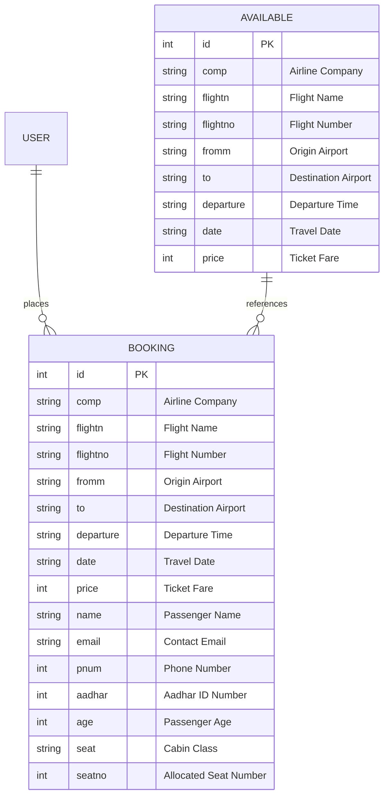

# ✈️ QuickSky Flights - Flight Booking & Reservation System

QuickSky Flights is a full-featured airline reservation web application built with **Django 6** and custom CSS. It provides an end-to-end flight booking experience—enabling passengers to browse scheduled flights, book tickets across multiple cabin classes, manage personal itineraries, update passenger details, and cancel reservations.

---

## 🌟 Key Features

### 🛫 Flight Catalog & Scheduling
- **Live Flight Availability**: Real-time display of all scheduled domestic and international flights (`Available` model).
- **Flight Itinerary Details**: Airline operator, flight number, origin, destination airport, departure time, travel date, and fare in INR (₹).
- **One-Click Booking Gateway**: Direct transition from flight listings into the passenger reservation form.

### 🎫 Passenger Ticket Booking Workflow
- **Pre-filled Flight Metadata**: Flight number, operator, route, departure time, and base fare are locked from the schedule database to prevent tampering.
- **Passenger Information Capture**: Records passenger name, contact email, phone number, government ID (Aadhar Number), and age.
- **Cabin Class Selection**: Choose between **Economy**, **Business**, and **First Class** seating tiers.
- **Seat Number Allocation**: Custom designated seat assignment for each booked passenger.

### 📋 Booking Management & Self-Service
- **User Booking Dashboard** (`/base/booking/`): Displays all active boarding passes and booked tickets tied to the authenticated user.
- **Update Reservation** (`/base/update_/<id>`): Self-service portal to update passenger contact details, age, or seat class without cancelling.
- **Ticket Cancellation** (`/base/delete/<id>`): One-click reservation cancellation with instant database cleanup.
- **Travel History & Support**: Dedicated interfaces for past flight history (`/base/history/`) and customer support (`/base/support/`).

### 🔐 User Authentication & Account Management
- **Passenger Registration & Login**: Django session-based authentication with duplicate username validation.
- **Profile Dashboard & Updates**: View and edit user profile details (`fname`, `lname`, `email`, `username`).
- **Forgot Password Workflow**: Session-secured self-service password recovery flow (`/fpasw/`).
- **Auth-Aware Navigation**: Adaptive navigation bar that presents booking, history, and profile links to authenticated users and login/signup to guests.

### 🛡️ Administrative Portal
- Registered Django admin interface for flight operations staff:
  - **Available Flights Admin**: Search flights by number, airline, or route, with filters by date and airline.
  - **Bookings Admin**: Comprehensive view of passenger reservations with search by name, Aadhar, or flight number.

---

## 🛠️ Tech Stack

| Layer | Technology |
| :--- | :--- |
| **Backend Framework** | [Django 6.0.5](https://www.djangoproject.com/) |
| **Language** | Python 3.10+ |
| **Database** | SQLite3 (Configured in `settings.py`) |
| **Frontend** | HTML5, Django Template Language (DTL), Custom Responsive CSS3 |
| **Version Control** | Git & GitHub |

---

## 🗄️ Database Schema



---

## 📁 Project Structure

```text
flight/
├── .gitignore                    # Excludes venv, db.sqlite3, __pycache__
├── requirements.txt              # Python project dependencies
├── README.md                     # Comprehensive documentation
│
└── myproject/                    # Main Django project container
    ├── manage.py                 # Django management CLI
    │
    ├── myproject/                # Project root configuration
    │   ├── __init__.py
    │   ├── asgi.py               # ASGI configuration
    │   ├── settings.py           # App settings, apps, templates
    │   ├── urls.py               # Root router (admin, base, auth_user)
    │   └── wsgi.py               # WSGI configuration
    │
    ├── auth_user/                # Authentication & User Accounts App
    │   ├── admin.py
    │   ├── apps.py
    │   ├── models.py
    │   ├── urls.py               # Routes for login, register, profile, fpasw
    │   ├── views.py              # Login, register, profile, update, fpasw views
    │   ├── migrations/           # Auth app migrations
    │   └── templates/            # Auth templates
    │       ├── fpasw.html        # Password recovery
    │       ├── login_.html       # Login form
    │       ├── logout_.html      # Logout view
    │       ├── profile.html      # User profile dashboard
    │       ├── register.html     # Registration form
    │       └── update.html       # Profile update form
    │
    ├── base/                     # Core Flight Booking App
    │   ├── admin.py              # AvailableAdmin, BookingAdmin registrations
    │   ├── apps.py
    │   ├── models.py             # Available, Booking models
    │   ├── urls.py               # Flight catalog & booking routes
    │   ├── views.py              # Flight search, booking, update, cancel views
    │   ├── migrations/           # Flight app migrations (0001 - 0005)
    │   └── templates/            # Flight templates
    │       ├── about.html        # About page
    │       ├── book.html         # Plane ticket booking form
    │       ├── booking.html      # My Bookings / Boarding Pass dashboard
    │       ├── history.html      # Travel history
    │       ├── home.html         # Available flights catalog
    │       ├── support.html      # Customer service
    │       └── update_.html      # Update reservation details form
    │
    ├── templates/                # Shared layout templates
    │   ├── main.html             # Base HTML template wrapper
    │   └── nav.html              # Top navigation bar
    │
    └── static/                   # Static assets
        └── style.css             # Navigation & global styles
```

---

## ⚙️ Installation & Local Setup

### 1. Clone the Repository
```bash
git clone https://github.com/Sushanth-yadav/<repo-name>.git
cd <repo-name>
```

### 2. Set Up Virtual Environment
- **Windows (Command Prompt / PowerShell):**
  ```powershell
  python -m venv venv
  .\venv\Scripts\activate
  ```
- **macOS / Linux:**
  ```bash
  python3 -m venv venv
  source venv/bin/activate
  ```

### 3. Install Dependencies
```bash
pip install -r requirements.txt
```

### 4. Run Database Migrations
Navigate into the directory containing `manage.py` and run:
```bash
cd myproject
python manage.py migrate
```

### 5. Create an Administrator Account
```bash
python manage.py createsuperuser
```
Follow the prompts to enter an admin username, email, and password.

### 6. Populate Available Flights (Admin Panel)
1. Start the server:
   ```bash
   python manage.py runserver
   ```
2. Navigate to **[http://127.0.0.1:8000/admin/](http://127.0.0.1:8000/admin/)** and log in with your superuser credentials.
3. Under **Base > Availables**, add scheduled flights (e.g., Indigo, Air India, Emirates) with departure times, dates, routes, and prices.

### 7. Access the Application
- **Home / Available Flights**: 👉 **[http://127.0.0.1:8000/base/](http://127.0.0.1:8000/base/)**
- **User Login**: 👉 **[http://127.0.0.1:8000/](http://127.0.0.1:8000/)**
- **My Bookings**: 👉 **[http://127.0.0.1:8000/base/booking/](http://127.0.0.1:8000/base/booking/)**

---

## 🧭 URL Routing Reference

### Flight Booking & Itineraries (`base`)
| URL Pattern | View Function | Description |
| :--- | :--- | :--- |
| `/base/` | `home` | Catalog of available scheduled flights |
| `/base/book/<id>` | `book` | Ticket booking form for selected flight |
| `/base/booking/` | `booking` | Boarding passes & active reservations |
| `/base/update_/<id>` | `update_` | Update passenger details & seat assignment |
| `/base/delete/<id>/` | `delete` | Cancel flight reservation |
| `/base/history/` | `history` | Booking history view |
| `/base/support/` | `support` | Customer service & support |
| `/base/about/` | `about` | Portal background & information |

### Passenger Authentication (`auth_user`)
| URL Pattern | View Function | Description |
| :--- | :--- | :--- |
| `/` | `login_` | Passenger login page |
| `/register/` | `register` | New passenger registration |
| `/profile/` | `profile` | Passenger profile overview |
| `/update/` | `update` | Edit profile credentials |
| `/fpasw/` | `fpasw` | Self-service password reset |
| `/logout_/` | `logout_` | Terminate session and logout |

---

## 🔒 Security Best Practices
- **Production Secret Key**: Replace `SECRET_KEY` in `settings.py` with an environment variable (`.env`).
- **Production Debug**: Ensure `DEBUG = False` and set `ALLOWED_HOSTS` before deploying.
- **Sensitive Data**: Exclude local SQLite databases (`db.sqlite3`) and credentials from version control via `.gitignore`.

---

## 📄 License
This project is open-source and available under the [MIT License](LICENSE).
